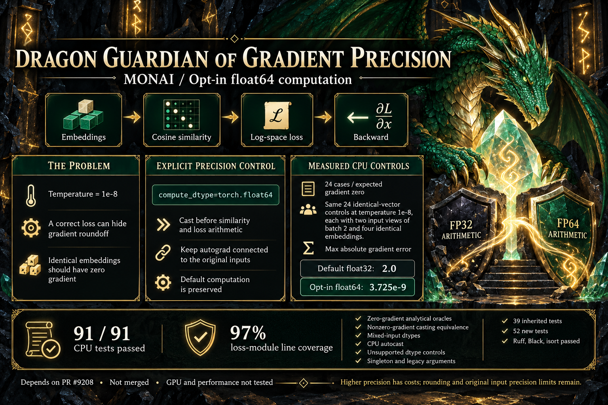

# Precisão de gradientes: contribuição com tema dragão

Issue: [MONAI #9209](https://github.com/Project-MONAI/MONAI/issues/9209). Novo PR: [MONAI #9210](https://github.com/Project-MONAI/MONAI/pull/9210), publicado como rascunho dependente. Esta contribuição depende do [PR #9208](https://github.com/Project-MONAI/MONAI/pull/9208). Commit do incremento: `116bc2a409604fd05953634a8314ac2bb3169ee3`; base do incremento: `49542ec865f11a7b54a44e16fc367633d1f77041`.



## Arquitetura e problema

As duas versões de uma imagem produzem embeddings. ContrastiveLoss compara suas similaridades, calcula a perda e propaga gradientes de volta às entradas. Temperaturas pequenas amplificam arredondamento no backward da similaridade de cosseno. Uma perda correta pode coexistir com um gradiente impreciso.

Em 24 casos de vetores idênticos não nulos na temperatura `1e-8`, o gradiente matemático é zero. Cada caso repete um vetor quatro vezes, dividido em duas entradas de lote 2. Os tamanhos de características são 3, 5 e 17. O erro máximo observado no cálculo padrão foi `2.0`.

## Solução explícita

```python
loss_fn = ContrastiveLoss(temperature=1e-8, compute_dtype=torch.float64)
loss = loss_fn(embeddings_a, embeddings_b)
loss.backward()
```

O novo parâmetro opcional converte os embeddings conectados ao autograd antes da similaridade e do cálculo da temperatura. Nos mesmos 24 controles, o erro máximo caiu para `3.725290298461914e-9`. A loss retorna float64 nesse modo, mas entradas e armazenamento de seus gradientes mantêm os dtypes originais. O modo padrão é preservado. Também é possível selecionar float32 explicitamente; demais valores são rejeitados.

Converter apenas a loss pronta para float64 é tarde demais para melhorar os cálculos anteriores. A opção encapsula a conversão manual já validada e permite configurar a precisão na própria loss. Não adiciona limiar automático, clipping de gradiente ou alteração da semântica do epsilon.

## Validação

| Verificação | Resultado |
| --- | --- |
| Fase inicial na implementação do PR pai | 49 novos casos falharam por ausência da opção; 39 herdados passaram |
| Suíte final | **91 aprovados**, sem skips: 39 herdados e 52 novos |
| Controles numéricos | 24 casos por modo; erro máximo 2.0 versus 3.725e-9 |
| Cobertura do módulo da loss | **97%**, 34 de 35 linhas executáveis |
| Contratos | Gradientes analíticos, equivalência à conversão manual, dtypes mistos, autocast CPU, entradas preservadas, valores inválidos, lote unitário e argumentos legados |
| Estilo | Ruff, Black e isort aprovados |
| Isolamento | Dependências auxiliares, caches, logs temporários e testes em sandbox removido ao terminar |

Ambiente: Windows, Python 3.14.1, PyTorch 2.12.1+cpu e NumPy 2.3.5. Uma thread por biblioteca numérica. Evidências: [fase inicial](qa/gradient_precision/red_results.json), [validação final](qa/gradient_precision/green_results.json), [testes](qa/gradient_precision/green_tests.txt), [cobertura](qa/gradient_precision/green_coverage.txt) e [medição da opção](qa/gradient_precision/precision_observation.json).

O JSON de validação registra o checkout anterior ao commit final. Os hashes SHA-256 da implementação e dos testes foram conferidos e coincidem com os arquivos commitados.

Para repetir, use o checkout do código no commit `116bc2a409604fd05953634a8314ac2bb3169ee3`. Copie os três scripts Python desta pasta documental para `qa/gradient_precision/` na raiz desse checkout (o validador resolve os caminhos a partir dessa localização). Com PyTorch e NumPy instalados, execute na raiz:

```powershell
python -B qa/gradient_precision/run_validation.py --phase green
python -B qa/gradient_precision/observe_precision.py
```

## Limites e dependência

Float64 reduz o erro nos casos avaliados; não garante gradientes exatos para qualquer temperatura. Não recupera informação já quantizada nos embeddings nem aumenta o intervalo representável de gradientes armazenados em entradas de menor precisão. Exige suporte do dispositivo e tem custos adicionais não medidos. GPU, distribuição, integração completa, treinamento e build de documentação não foram executados.

O PR pai trata do overflow e da avaliação em escala logarítmica. Esta nova contribuição adiciona uma política explícita de precisão. Enquanto o pai estiver aberto, o novo PR será um rascunho dependente e sua revisão deve usar o diff incremental a partir de `49542ec8`. Não foi criada outra implementação do ajuste de overflow.

## Infográfico e divulgação

O tema **Dragon** foi solicitado explicitamente. O helper foi executado diretamente com `python scripts/pr_infographic_prompt.py --title ... --summary ... --docs ... --json`, com [briefing final](qa/gradient_precision/infographic_brief.json). A ferramenta nativa OpenAI image_gen gerou a imagem nova, inspecionada e salva em `infographic.png`.

Prompt visual: dragão esmeralda guardando um cristal de precisão; fundo obsidiana, marfim e ouro; fluxo embeddings → similaridade → loss → backward; três painéis sobre problema, compute_dtype e controles CPU; 91 testes, 97% de cobertura e limitações explícitas. Nenhum gráfico ou resultado de treinamento é apresentado.

A [imagem pública](https://raw.githubusercontent.com/JoaoMarcos44/MONAI/e4b2cddafc1d2027e16a2b7ddb78ef8915f287ed/docs/pr-assets/gradient-precision/infographic.png) é hospedada em branch documental separada. SHA-256 local: `9411E5A44D3690662675E9CF8E895946BE479BA8F8FC22DC4DB286A2C47F3206`.

Análise, código, testes e textos preparados com assistência do OpenAI Codex e revisões independentes. Imagem gerada com a ferramenta nativa de imagens da OpenAI. O autor responsável deve revisar a contribuição conforme a política do MONAI.
